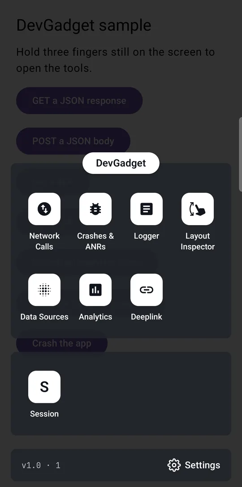
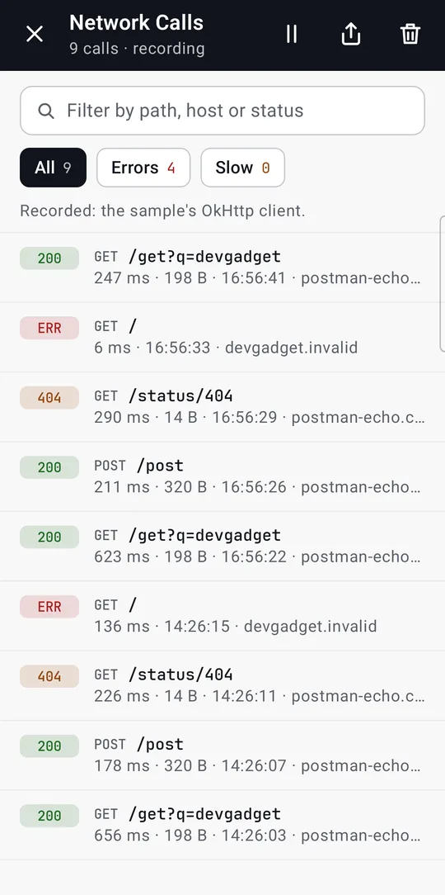
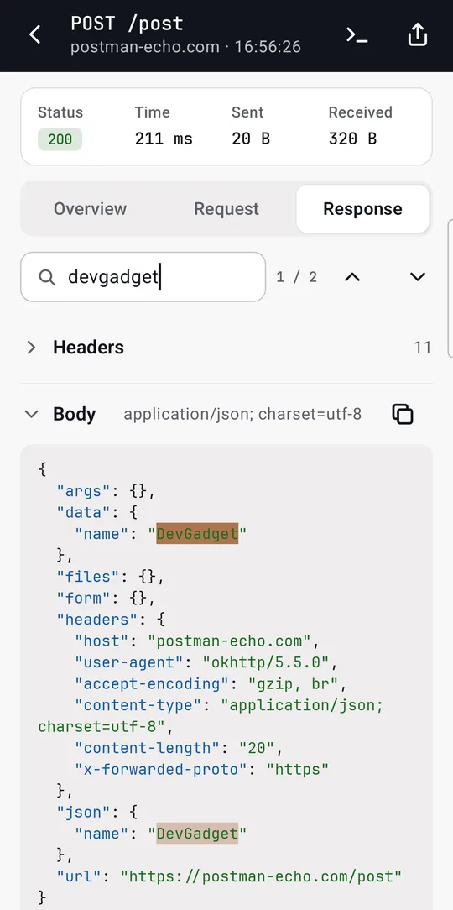
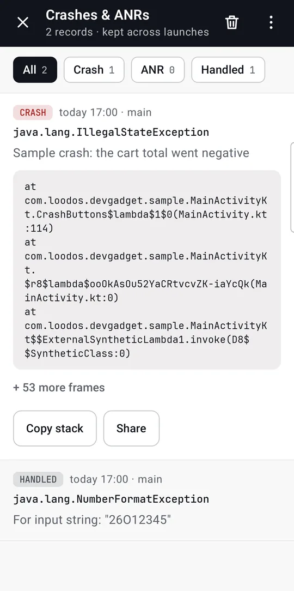
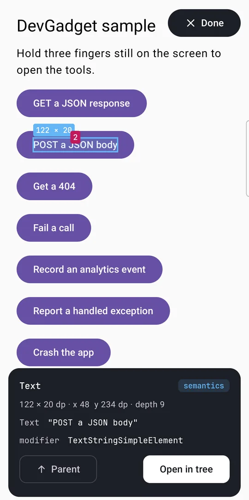
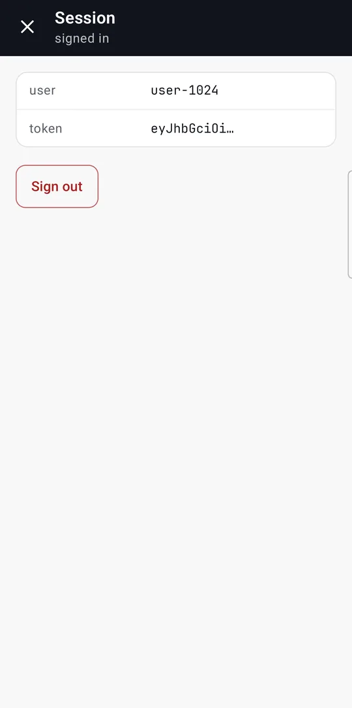

<h1 align="center">DevGadget for Android</h1>

<p align="center">
  <a href="https://github.com/loodos/devgadget-android-sdk/releases"></a>
  
  
</p>

<p align="center">
  An in-app debug toolbox for Android apps, by Loodos.<br/>
  Hold three fingers still on any screen, tap the floating button, or long-press the app icon,<br/>
  and a sheet of tools opens over the app.
</p>

---

| Tool | What it shows |
|---|---|
| **Network Calls** | Every call on the recorded HTTP clients, with headers, bodies, cURL and find-in-body. Kept on disk across launches. |
| **Crashes & ANRs** | Uncaught exceptions, main-thread stalls and exceptions the app reports, kept across the crash. |
| **Logger** | This process's logcat. |
| **Layout Inspector** | The screen under the tools as one tree (Views, and Compose semantics), browsable or picked on the live screen. |
| **Data Sources** | Shared preferences and DataStore (editable), SQLite (read-only, with a query box). |
| **Analytics** | Every call the app makes on a vendor's analytics client, one tab per vendor. |
| **Deeplink** | Fire a URL at the app: who handles it and what the manifest declares. |

Your project adds its own tools next to these, with the same look.

<table>
  <tr>
    <td></td>
    <td></td>
    <td></td>
  </tr>
  <tr>
    <td align="center">Three fingers: the tools over any screen</td>
    <td align="center">Network Calls</td>
    <td align="center">Find inside a body</td>
  </tr>
  <tr>
    <td></td>
    <td></td>
    <td></td>
  </tr>
  <tr>
    <td align="center">Crashes, kept across the crash</td>
    <td align="center">Layout Inspector on the live screen</td>
    <td align="center">Your own panel, same look</td>
  </tr>
</table>

## Requirements

| | Minimum |
|---|---|
| minSdk | 24 |
| compileSdk | 36 |
| Kotlin | 2.0 |
| AGP | 8.9 |
| Compose BOM | 2024.12.01 (the app does not need to use Compose itself) |
| OkHttp | 4.12.0 (5.x works too) |

## Installation

DevGadget is a public Maven repository served from this repository. No account or token is needed.

**`settings.gradle.kts`:**

```kotlin
dependencyResolutionManagement {
    repositories {
        exclusiveContent {
            forRepository { maven("https://loodos.github.io/devgadget-android-sdk") }
            filter { includeGroup("com.loodos.devgadget") }
        }
        google()
        mavenCentral()
    }
}
```

**`app/build.gradle.kts`**, debug only. One line brings every tool, the OkHttp adapter and the
design kit for your own panels:

```kotlin
dependencies {
    debugImplementation("com.loodos.devgadget:devgadget:0.1.0-alpha07")
}
```

Or pick tools one by one, with the BOM keeping their versions together:

```kotlin
dependencies {
    debugImplementation(platform("com.loodos.devgadget:bom:0.1.0-alpha07"))
    debugImplementation("com.loodos.devgadget:runtime")        // the shell, required
    debugImplementation("com.loodos.devgadget:network-okhttp") // network tool + OkHttp adapter
    debugImplementation("com.loodos.devgadget:crashes")
    debugImplementation("com.loodos.devgadget:logger")
    debugImplementation("com.loodos.devgadget:inspector")
    debugImplementation("com.loodos.devgadget:datasource")
    debugImplementation("com.loodos.devgadget:analytics")
    debugImplementation("com.loodos.devgadget:deeplink")
    debugImplementation("com.loodos.devgadget:ui")             // the kit, for your own panels
}
```

That is enough for every tool that needs nothing from the app. DevGadget installs itself through
Jetpack App Startup, before `Application.onCreate`. Open it with a three-finger hold on any screen
or by long-pressing the app icon, or turn on the floating button in DevGadget's settings.

> **Status: alpha.** Versions are `0.1.0-alpha01`, `-alpha02`, …, then `-beta`, `-rc` and the
> stable version, the AndroidX way. The API may change between alphas.

## Connecting the app

Two tools need a line from the app: the network tool sits on the HTTP client, and the analytics
tool hears vendor calls. Keep those lines in the **debug source set**, with a same-named no-op in
release, so `src/main` never names DevGadget:

```kotlin
// src/debug/kotlin/…/DebugHooks.kt
internal object DebugHooks {
    fun interceptors(): List<Interceptor> = listOf(DevGadgetInterceptor())
    fun track(provider: String, name: String, vararg args: Any?) =
        DevGadget.analytics.record(provider, name, args.toList())
}

// src/release/kotlin/…/DebugHooks.kt
internal object DebugHooks {
    fun interceptors(): List<Interceptor> = emptyList()
    fun track(provider: String, name: String, vararg args: Any?) = Unit
}

// src/main
OkHttpClient.Builder().apply { DebugHooks.interceptors().forEach(::addInterceptor) }.build()
```

## Configuration

A `DevGadgetConfigurator` in the debug source set configures the tools before anything installs:

```kotlin
// src/debug/kotlin/com/yourapp/debug/AppGadgetConfigurator.kt
class AppGadgetConfigurator : DevGadgetConfigurator {
    override fun configure(context: Context, config: DevGadgetConfig.Builder) = with(config) {
        network { scopeNote = "Not recorded: the analytics SDKs' own clients." }
        analytics { providers("Firebase", "Adjust") }
        dataSources { ownerRule(prefix = "acme-", owner = "Acme SDK") }
        panel(EnvironmentPanel()) // a tool of your own
    }
}
```

The debug manifest names that class, so DevGadget can find it:

```xml
<!-- src/debug/AndroidManifest.xml -->
<application>
    <meta-data
        android:name="com.loodos.devgadget.configurator"
        android:value="com.yourapp.debug.AppGadgetConfigurator" />
</application>
```

`android:name` is a fixed key. `android:value` is your class's full name.

## Your own tools

Anything that knows your app belongs in your app: its backend switcher, its feature flags, its
session. It is a `Panel`, built from the UI kit in `com.loodos.devgadget:ui`, so it looks like the
built-in tools in light and in dark:

```kotlin
class EnvironmentPanel : Panel {
    override val id = "environment"
    override val title = "Environment"

    @Composable
    override fun Content() {
        PanelChrome(subtitle = "test · override")
        Column(Modifier.padding(16.dp), verticalArrangement = Arrangement.spacedBy(16.dp)) {
            FactCard(facts = listOf("backend" to "api.test.example.com", "version" to "3.0.2"))
            Callout("The app restarts to apply.", tint = GadgetColors.warn())
            GadgetButton("Switch to prod", onClick = ::switchToProd, primary = true)
        }
    }
}
```

## It cannot ship in a release build

1. **`debugImplementation` only.** No DevGadget class exists in a release APK.
2. **Nothing in `src/main` names it.** It installs itself, and the app's hooks live in the debug
   source set.
3. **Check it in CI.** This must print `0`:

```bash
./gradlew :app:dependencies --configuration releaseRuntimeClasspath | grep -c devgadget
```

---

<p align="center">© Loodos. All rights reserved.</p>
